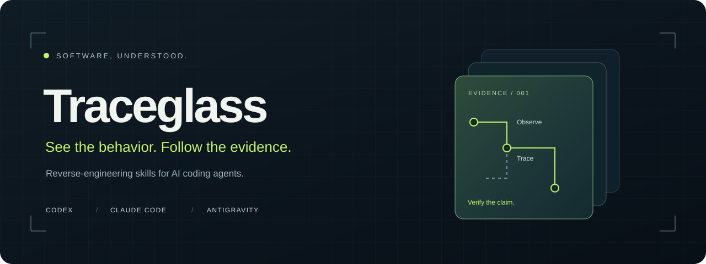
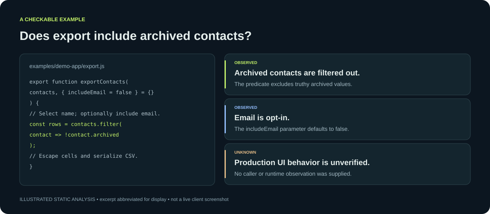
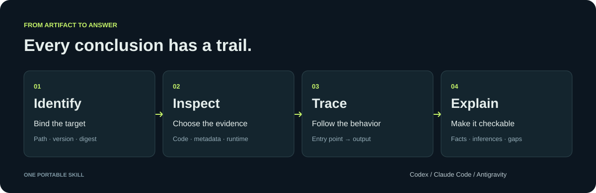

<p align="center"></p>

<p align="center">
  
  
  
  <a href="LICENSE"></a>
</p>

<h3 align="center">Turn unfamiliar software into explanations you can verify.</h3>
<p align="center">A portable reverse-engineering skill for AI coding agents.<br>Trace features. Compare releases. Keep the receipts.</p>
<p align="center"><a href="#try-it">Quick start</a> · <a href="examples/walkthrough.md">Example investigation</a> · <a href="docs/installation.md">Installation</a> · <a href="docs/backends.md">Analysis backends</a></p>

---

## From “probably” to “here’s the evidence”

An app has an export button. A bundle contains an analytics URL. Two releases behave differently. What can you actually prove?

**Traceglass gives your agent a repeatable way to answer:** identify the artifact, follow the relevant code or behavior, and deliver a report that separates observations, inferences, and open questions.

| Ask your agent | Get back |
| :--- | :--- |
| “How does this packaged app export data?” | An entry point → transformation → output trace with source locations |
| “What changed between these two builds?” | A scoped behavioral comparison, with evidence from each version |
| “Does this binary contain this feature?” | Supported findings and explicit search limits |
| “Help me reproduce this interaction.” | A behavior specification separating observations from implementation choices |

<p align="center"></p>

[Inspect the fixture and evidence →](examples/walkthrough.md)

## Try it

Download or clone this repository, open a terminal in its root, and use Python 3.9+ to install into your target project:

```bash
git clone https://github.com/arhanali003/traceglass.git
cd traceglass

# Pick your client. Preview the destination first.
python3 scripts/install.py --client codex --project /path/to/project --dry-run
python3 scripts/install.py --client codex --project /path/to/project
```

Use `--client claude`, `--client antigravity`, or `--client all` instead. The installer copies the skill and its references; it refuses to overwrite an existing installation. It does not install analysis engines or change MCP settings.

Then start a fresh agent session in that project and ask:

```text
Use Traceglass to explain how /absolute/path/to/app implements CSV export.
Trace the entry point through to the output. Cite the evidence and flag
anything that static analysis cannot establish.
```

**Want a tiny first run?** Install into this checkout using `--project .`, then ask your agent to investigate `examples/demo-app/export.js`. See the [walkthrough](examples/walkthrough.md) for a checkable result. No MCP server or external package required.

## Recover source that actually ships

The companion **Source Recovery** skill produces files, hashes, and a provenance manifest. It recovers readable scripts and embedded source-map text; it guides the agent to available decompilers for compiled components. Decompiled output is labeled approximate, never passed off as the original source project.

```bash
python3 scripts/install.py --client all --project /path/to/project --skill source-recovery
```

Ask: **“Use source-recovery to recover available source from this installed app into a new local directory.”**

For compiled macOS components, `native_report.py` exports static metadata, symbols, and optional assembly. The [deep native workflow](skills/source-recovery/references/native-depth.md) adds provider discovery, scoped decompilation, and explicit failure tracking. A compatible connected decompiler is required for pseudocode.

For complete **local bundle file preservation**, the companion `collect_bundle.py` copies regular files with SHA-256 verification and records symlink metadata. This preserves opaque binaries and resources; it does not decode them or recover cloud content.

The included helper supports loose UTF-8 source, standalone JSON source maps, inline data maps, and embedded indexed-map sections. Archives and native binaries require separate tools. It does not execute the target or fetch remote source maps. [Read the skill →](skills/source-recovery/SKILL.md)

## Recheck evidence before an agent uses it

The Source Recovery companion includes a read-only bundle verifier:

```bash
python3 skills/source-recovery/scripts/verify_bundle.py --bundle /path/to/collected-output
```

It checks saved files against `bundle-manifest.json`, returning JSON and exit
codes for intact, failed, or invalid evidence. It detects changed/missing files
and preserves collection-error reporting. A matching manifest does not establish
authenticity or completeness. [Installation and command contract](docs/bundle-verification.md)
· [Runnable example](examples/verify-bundle.md).

## One workflow. Three clients.

| Client | Project installation | Explicit invocation |
| :--- | :--- | :--- |
| Codex | `.agents/skills/traceglass/` | `$traceglass` |
| Claude Code | `.claude/skills/traceglass/` | `/traceglass` |
| Antigravity | `.agents/skills/traceglass/` | Ask to use Traceglass |

These paths follow the clients’ documented skill discovery conventions. Installer behavior is tested locally; live end-to-end verification in all three clients is still pending. [Details and sources →](docs/installation.md)

## Follow the trace

<p align="center"></p>

- **Portable instructions.** One skill, shared references, client-specific installation locations.
- **Focused investigations.** Start from a question; expand only where the evidence needs it.
- **Useful handoffs.** Reports preserve artifact identity, source locations, coverage, and next steps.
- **Optional analysis backends.** Use ordinary tools for readable artifacts, or connect REA for supported binary and runtime investigations.

Traceglass is an instruction package. Native decompilation, archive decoding, and runtime observation depend on tools available in your agent session. It does not bundle an analysis engine. [Capability boundaries →](docs/backends.md)

## Built to be inspected

```text
skills/traceglass/       Portable skill and investigation playbooks
examples/               Small fixture and worked investigation
scripts/install.py      Dependency-free, non-overwriting installer
assets/                 Editable banner, workflow, and report artwork
tests/                  Installer, recovery, preservation and verification checks
```

Read the [skill](skills/traceglass/SKILL.md), try the [example](examples/walkthrough.md), or contribute a [reproducible investigation](CONTRIBUTING.md). If Traceglass helps you understand a piece of software, a star helps others find it.

## Credits & license

Inspired by the evidence-oriented approach of [Reverse Engineer Anything (REA)](https://github.com/morluto/rea). Traceglass provides separately authored instructions, packaging, examples, and presentation; REA is an optional external backend. This project is not affiliated with REA, OpenAI, Anthropic, or Google. See [provenance](docs/provenance.md).

[MIT](LICENSE) for this repository. External tools retain their own licenses.

## Early beta: try the tools without a model

This checkout is preparing **0.2.0b1**; it is not a published package-manager release.
Python 3.9+ is supported; CI targets 3.9 and 3.13 on Linux, macOS and Windows.
Native reports additionally require macOS tools. Live execution in each AI client
remains unverified.

From this repository root, choose fresh output directories:

```sh
python3 scripts/install.py --version
python3 skills/source-recovery/scripts/collect_bundle.py --target examples/demo-app --output demo-bundle
python3 skills/source-recovery/scripts/verify_bundle.py --bundle demo-bundle
```

Expected: `Traceglass 0.2.0b1`, one copied file, then JSON containing `status: "ok"`,
`checked_files: 1`, and exit 0. This is useful for retaining a small artifact before
changing it and detecting later evidence tampering. It does not establish what a
production application executed. Use `python` instead of `python3` on Windows if
needed. Recovery/collection output must be outside the target; reruns need new paths.

For a fuller local walkthrough, invalid inputs, larger fixtures and feedback, see
[BETA_TESTING.md](BETA_TESTING.md). [CLI and troubleshooting](docs/cli.md) explains
all exit codes. In particular, recovery exit 2 now indicates recorded skips.
[Security boundaries](SECURITY.md) describe private-data and filesystem limits.

Build a local distribution with
`python3 scripts/build_release.py --output dist/traceglass-0.2.0b1.zip`.
It includes an inventory of file hashes and preserves the installer layout.
`python3 scripts/smoke_release.py` builds and checks an unpacked copy in a temporary
directory. These commands do not publish anything. There is no pip-installable
Traceglass package in this repository. [Draft beta notes](docs/releases/v0.2.0b1.md).
